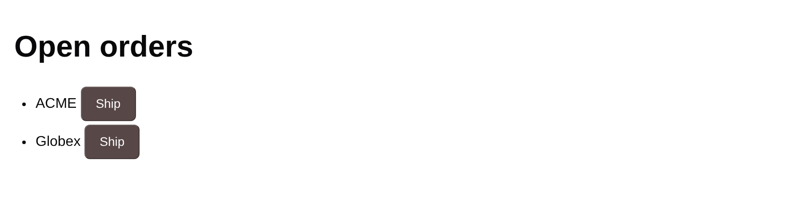
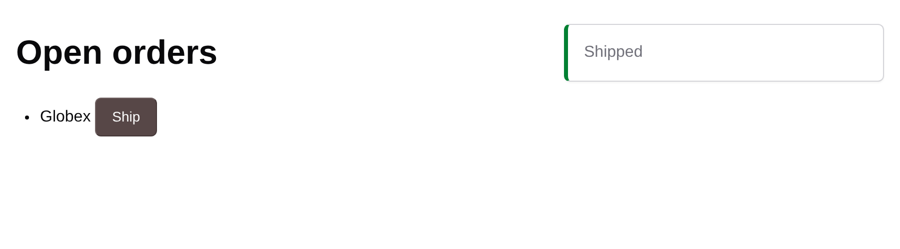
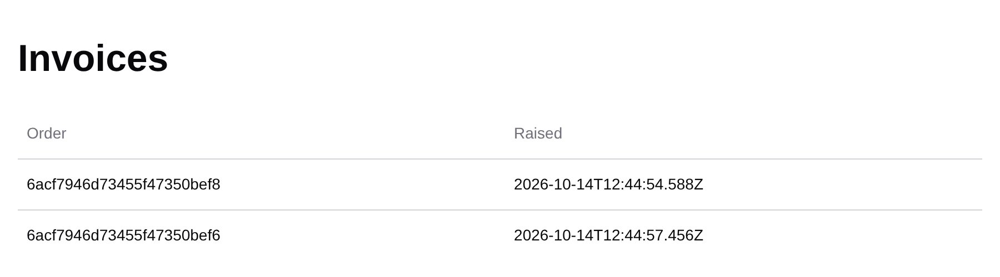

# fullstack4j skill

An agent skill for building features in a [fullstack4j](https://fullstack4j.dev) application:
Spring Boot, Apache Wicket, Spring Modulith and MongoDB, with one slice per feature and each
slice carrying its own spec in `package-info.java`. It is a plain `SKILL.md` with a
`references/` folder, so it works with Claude Code and any other agent that loads
directory-based skills.

fullstack4j is an offering of [allwerker eG](https://allwerker.com/en/), a Munich cooperative of
senior engineers, which sets up, staffs and coaches small teams building this way.

## See it run

The app in [`example/`](example/) follows every rule the skill teaches. It has two slices,
`ordering` and `billing`, that know nothing of each other beyond one event.

<picture>
  <source media="(prefers-color-scheme: dark)" srcset="docs/screenshots/orders-dark.png">
  
</picture>

**1.** `ordering` lists the open orders: a plain Wicket page with Oat components and no
JavaScript build.

<picture>
  <source media="(prefers-color-scheme: dark)" srcset="docs/screenshots/shipped-dark.png">
  
</picture>

**2.** "Ship" updates the list through Ajax, shows a toast and publishes `OrderShipped`.

<picture>
  <source media="(prefers-color-scheme: dark)" srcset="docs/screenshots/invoices-dark.png">
  
</picture>

**3.** `billing` listened to `OrderShipped` and raised an invoice. It never calls `ordering`.

## What the skill does

- **`/fullstack4j new <feature>`** asks you about the feature until the rules are clear, proposes
  which slices it belongs to, and writes the spec into the slice's `package-info.java`: its
  operations, numbered requirements in EARS, events, entities and what's out of scope. No code
  yet.
- **`/fullstack4j apply <slice>`** writes a test for every requirement id, then the code, and runs
  `./mvnw verify` until it is green. After three rounds it stops and shows you what still fails.
- For any other change in a fullstack4j project, it applies the same rules without being asked.

A spec looks like this, and every `R…` id in it has a test with that id in its `@DisplayName`:

```java
/// # Ordering
/// > Take a customer's order and see it through until it ships.
///
/// ## Operations
/// - `ship-order`: hand an open order over to shipping (`Orders.ship`)
///
/// ## Requirements
/// ### R2: Ship an order
/// - R2.1 — When an open order is shipped, the slice shall no longer
///   list it as open.
/// - R2.2 — When an open order is shipped, the slice shall publish
///   `OrderShipped`.
/// - R2.3 — If the order has already shipped, then the slice shall
///   reject the request.
@ApplicationModule(displayName = "Ordering", allowedDependencies = {})
package com.acme.shop.ordering;
```

The rules it works by:

- One feature is one slice, and one Spring Modulith module.
- A slice's base package is public (its spec, pages and events); everything else sits in
  `internal`, and `verify()` fails when another slice reaches in.
- Slices talk through events first. When one has to call another, it goes through an interface
  and records in the called slice's base package, never through its documents.
- Every requirement has a test and every test has a requirement; `SpecTraceabilityTests` fails
  the build on a gap or drift.
- `ArchitectureTests` runs `verify()` and the fullstack4j rules from the starter's test starter.
  They check what a slice's public package holds, where documents live, how events travel, what
  pages keep between requests, and that no test is switched off.
- Done means `./mvnw verify` is green on JDK 25.

## Install

With Claude Code, as a plugin from this repository's marketplace:

```bash
claude plugin marketplace add danielbartl/fullstack4j-skill
claude plugin install fullstack4j@fullstack4j
```

Inside a session, `/plugin marketplace add danielbartl/fullstack4j-skill` and
`/plugin install fullstack4j@fullstack4j` do the same. The plugin brings the
[Wicket Oat skill](https://github.com/danielbartl/wicket-oat) with it, which knows the Oat
components, themes and layout classes the pages are built with. Invoke the skill as
`/fullstack4j new <slice>` or `/fullstack4j apply <slice>`, or just describe the feature: Claude
picks the skill up by itself. If another command is already called `fullstack4j`, use
`/fullstack4j:fullstack4j`.

The plugin follows this repository's commits. To get the latest, run
`/plugin marketplace update fullstack4j`, or turn on auto-update for the marketplace under
**Marketplaces** in `/plugin`.

Without the plugin, copy the skill folder instead:

```bash
# for all your projects
cp -r fullstack4j ~/.claude/skills/fullstack4j

# or for one project, committed with it
cp -r fullstack4j <your-project>/.claude/skills/fullstack4j
```

Add the [Wicket Oat skill](https://github.com/danielbartl/wicket-oat) the same way. Other agents:
point them at the `fullstack4j/` folder, or copy it to wherever your agent looks for skills.

## What's in here

```
.claude-plugin/
└── marketplace.json    the marketplace: the fullstack4j plugin and Wicket Oat
fullstack4j/            the skill, and the plugin
├── .claude-plugin/
│   └── plugin.json     plugin metadata, Wicket Oat as a dependency
├── SKILL.md            rules and the new/apply workflow
├── references/         spec format, slice layout, testing, project setup
└── assets/             ArchitectureTests, SpecTraceabilityTests
example/                the shop from the screenshots, built with the skill's rules
docs/screenshots/
```

CI builds the example and checks that the files in `fullstack4j/assets/` are identical to the
example's, so what the skill hands out is what passes there. It also validates the plugin and
the marketplace with `claude plugin validate`.

## How it was tested

Besides the example, the skill was given to a fresh agent with nothing else to go on: a project
straight from the generator and the request "a small app for booking meeting rooms". Following
the skill, it set the project up, declared two slices (`rooms` and `bookings`, 26 requirement
ids between them, linked by a `RoomRetired` event and a `BookableRooms` interface), and built
them until `./mvnw verify` passed with 39 tests. Its notes on where the skill was unclear went
straight back into it.

## Run the example

You need JDK 25 and Docker.

```bash
cd example
./mvnw verify                  # 16 tests: requirements, pages, architecture, spec traceability
./mvnw spring-boot:test-run    # http://localhost:8080 on a throwaway MongoDB, with demo orders
```

Use JDK 25 specifically: on Java 26 and later, Wicket 10.11 can't create the proxies behind
`@SpringBean`, and every page that injects a Spring bean fails. The example's pom refuses any
other JDK with a message saying so.

## Related

- [fullstack4j.dev](https://fullstack4j.dev): the approach and the offering
- [fullstack4j start](https://github.com/danielbartl/fullstack4j-start): the project generator
- [fullstack4j Spring Boot Starter](https://github.com/danielbartl/fullstack4j-spring-boot-starter):
  the whole stack in two dependencies
- [Wicket Spring Boot Starter](https://github.com/danielbartl/wicket-spring-boot-starter)
- [Wicket Oat](https://github.com/danielbartl/wicket-oat): components and themes for Wicket

## Credits

The idea of keeping each component's spec in its own `package-info.java`, with numbered EARS
requirements that each have a test, comes from [SBCE](https://sbce.space) by Adam Bien. This
skill keeps that and leaves out the boundary/control/entity layout in favour of Spring
Modulith's defaults. The requirement patterns are [EARS](https://alistairmavin.com/ears/) by
Alistair Mavin.

## License

[MIT](LICENSE)
